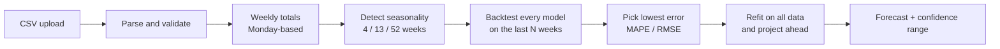

<div align="center">

# 📈 SalesForecast

**Turn a sales CSV into a forecast you can trust.**

Upload your history, and SalesForecast cleans it, trains several time-series models, backtests them on your most recent weeks,
picks the most accurate one and projects the weeks ahead with a confidence range. Every number on screen is computed from your data.

[**🚀 Live demo**](https://salesforecast-three.vercel.app/) &nbsp;·&nbsp; [Features](#-features) &nbsp;·&nbsp; [How it works](#-how-the-forecast-works) &nbsp;·&nbsp; [Run locally](#-run-it-locally) &nbsp;·&nbsp; [Roadmap](#%EF%B8%8F-roadmap)


</div>

---

## 🎯 Try it in 60 seconds

1. Open the **[live app](https://salesforecast-three.vercel.app/)** and create a free account.
2. Go to **Data Upload** and click **Try sample data** (a synthetic three-year retail dataset), or upload your own CSV.
3. Click **Confirm Import**. The dashboard fills with your projected revenue in ₹, growth, backtest error, confidence range and insights.

No CSV handy? The sample data is built in.

---

## ✨ Features

| | |
| --- | --- |
| **📤 Smart CSV import** | Handles quoted fields, `, ; \| tab` delimiters, `DD/MM/YYYY` and `MM/DD/YYYY` dates, and Indian or European number styles (`₹ 1,23,456.50`). Columns are auto-detected and can be changed by hand. |
| **✅ Honest validation** | Flags unreadable dates, non-numeric values, negatives, missing weeks (filled by interpolation), partial edge weeks, monthly-only data and histories that are too short. |
| **🤖 Model competition** | Damped Holt-Winters, linear trend + seasonality, seasonal naive and moving average. **Auto** mode backtests all of them and keeps the winner. |
| **🔁 Seasonality detection** | Finds a 4 / 13 / 52-week cycle from autocorrelation, or lets you choose one. |
| **📊 Confidence range** | The band comes from the hold-out error and widens the further ahead you look. |
| **🧠 Insights** | Plain-language alerts for low accuracy, high uncertainty, declining sales and slowing segments. |
| **🔬 Forecast analysis** | Model leaderboard (MAPE / RMSE), segment outlook, residuals, the detected seasonal pattern, and CSV export of the chart data. |
| **📑 Reports** | Downloadable HTML report (print to PDF), forecast CSV and segment CSV, with an export history. |
| **🗂️ Data management** | Dataset list, a factual profile of each dataset (trend, best and worst weeks, unusual weeks, category shares), weekly-data download, delete. |
| **⚙️ Saved defaults** | Choose your default horizon, confidence level, model, seasonality and outlier handling. |
| **🔒 Private by design** | Supabase Auth with Row Level Security: every user can read and change only their own data. |

---

## 🧠 How the forecast works



1. **Clean and aggregate.** The CSV becomes weekly totals. Partial first and last weeks are dropped, and empty weeks are filled by linear interpolation and reported as a warning.
2. **Find the rhythm.** The seasonal cycle comes from the autocorrelation of the de-trended series.
3. **Backtest.** Each model is fitted on all but the last *N* weeks, then scored on those *N* weeks using **MAPE** and **RMSE**.
4. **Forecast.** The best model is refitted on all the data and projected forward. The range is `prediction ± z · σ · √(1 + 0.1 · h)`, where σ is the larger of the hold-out and in-sample RMSE and *h* is the number of weeks ahead. It is a practical approximation, not an exact statistical interval.

The whole engine runs in the browser (`src/lib/forecast/`). It has **no dependencies**, no separate ML server, and is covered by automated tests.

---

## 🧰 Tech stack

| Layer | Technology |
| --- | --- |
| Framework | Next.js 15 (App Router), React 19, TypeScript |
| UI | Tailwind CSS, Recharts, Lucide icons, Sonner toasts, React Hook Form |
| Backend | Supabase: Auth, Postgres (JSONB), Row Level Security |
| Forecasting | Custom dependency-free TypeScript engine |
| Quality | Node test runner, GitHub Actions CI |
| Hosting | Vercel |

---

## 💻 Run it locally

**Requirements:** Node.js 22.6+ and a free [Supabase](https://supabase.com) project.

```bash
git clone https://github.com/Krishh-22/salesforecast.git
cd salesforecast
npm install
cp .env.example .env.local     # then fill in your Supabase URL and anon key
npm run dev                    # http://localhost:4028
```

### Database setup

In the Supabase **SQL Editor**, run every file in `supabase/migrations/` **in order**, oldest first. They create the tables,
Row Level Security policies, table permissions and the storage columns for weekly series and diagnostics. All of them are safe to run more than once.

Then, under **Authentication → URL Configuration**, set your **Site URL** and add your site address to **Redirect URLs**.

### Scripts

| Command | What it does |
| --- | --- |
| `npm run dev` | Development server on port 4028 |
| `npm run build` | Production build |
| `npm run start` | Run the production build |
| `npm test` | Tests for the forecasting engine, reports, profiling and settings |
| `npm run type-check` | TypeScript check |
| `npm run lint` | ESLint |

GitHub Actions (`.github/workflows/ci.yml`) runs the tests, type-check and build on every push.

---

## 📂 Project structure

```
src/
├── app/                      # Routes: dashboard, data-upload, forecast-configuration,
│                             #         forecast-analysis, reports-export, data-management, …
├── components/               # Layout and reusable UI
├── contexts/                 # Auth, datasets and forecast runs, notifications, theme
└── lib/
    ├── forecast/
    │   ├── data.ts           # CSV parsing, column detection, validation, weekly aggregation, sample data
    │   ├── engine.ts         # Models, backtesting, confidence ranges, run payloads
    │   ├── report.ts         # HTML / CSV reports, insights, ₹ formatting
    │   └── profile.ts        # Dataset statistics
    ├── settings.ts           # Saved forecast defaults
    └── supabase/             # Browser and server Supabase clients
supabase/migrations/          # Schema, security policies, permissions
tests/                        # Tests for the pure logic
```

---

## ⚠️ Known limitations

- **CSV only** (save Excel files as CSV first) and **weekly totals only**. Monthly-only data is rejected with an explanation.
- The models are classical statistical ones and use only past sales. They do not know about holidays, promotions or price changes.
- The confidence range is an approximation.
- Reports are generated in the browser. Print the HTML report to get a PDF.
- Export history and saved defaults live in the browser's local storage.
- Scheduled exports, e-mail notifications and team workspaces would need a server and are not built yet.

---

## 🗺️ Roadmap

- [ ] Excel import and monthly granularity
- [ ] Festival and promotion calendar features (Diwali, Eid, sale events)
- [ ] What-if scenarios (price and discount sliders)
- [ ] Python (FastAPI) service for Prophet and gradient-boosting models
- [ ] Team workspaces with shared datasets
- [ ] Scheduled report e-mails

---

## 👤 Author

Built by **Krishna** ([@Krishh-22](https://github.com/Krishh-22)) as a B.Tech Computer Science major project.

Originally based on [Maxx825/salesforecast](https://github.com/Maxx825/salesforecast). The forecasting engine, real data pipeline,
reports, security fixes and tests were rebuilt in this version.
